# AI Focus Assistant

An AI-powered productivity system that detects phone and gaze distractions during Pomodoro focus sessions, estimates real-time distraction risk, and turns session history into actionable analytics.

Built with **YOLOv8**, **MediaPipe**, **OpenCV**, and **Streamlit**.

---

## Demo

<a href="https://youtu.be/pXaMNblhLVE">
  
</a>

*Click the thumbnail to watch the full walkthrough on YouTube.*

Home screen → focus session → detection → session summary → Streamlit dashboard.

### Focus session app

**Home screen** — press **SPACE** to start a Pomodoro focus session.

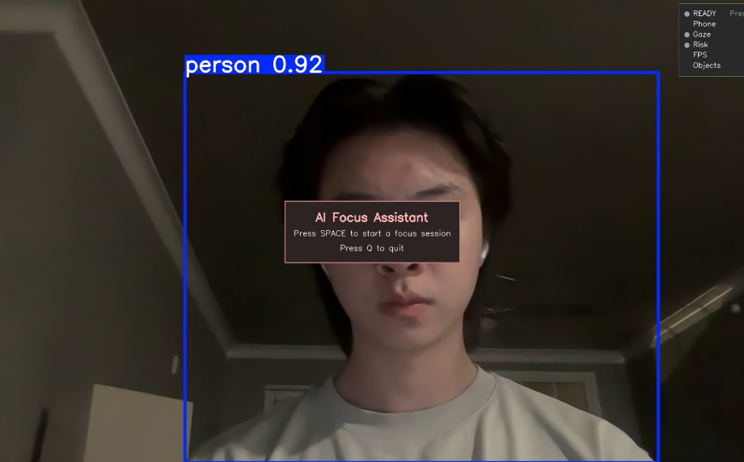

**Live HUD** — timer, gaze status, and distraction risk while focusing.

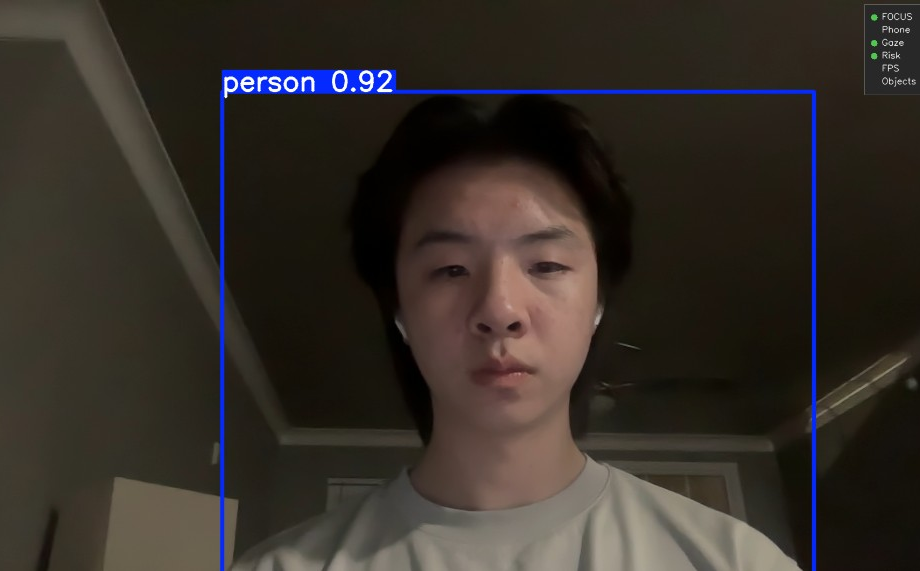

**Detection in action**

| Phone detection | Gaze-away detection |
| :---: | :---: |
| 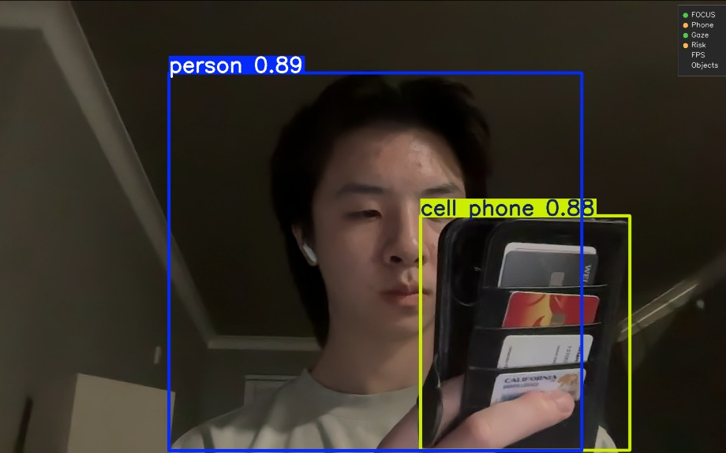 | 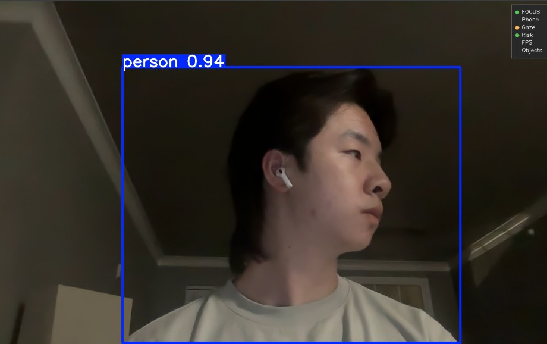 |

**Session summary** — focus score, distraction breakdown, and **Open Dashboard** button.

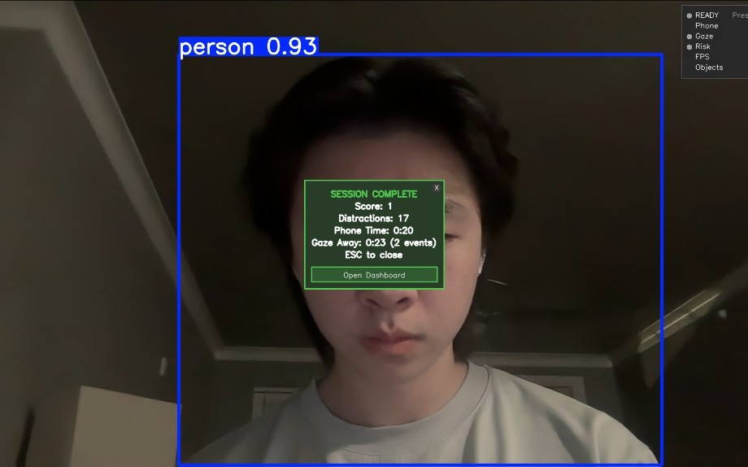

### Streamlit dashboard

**Overview** — aggregate metrics and focus score trend across sessions.

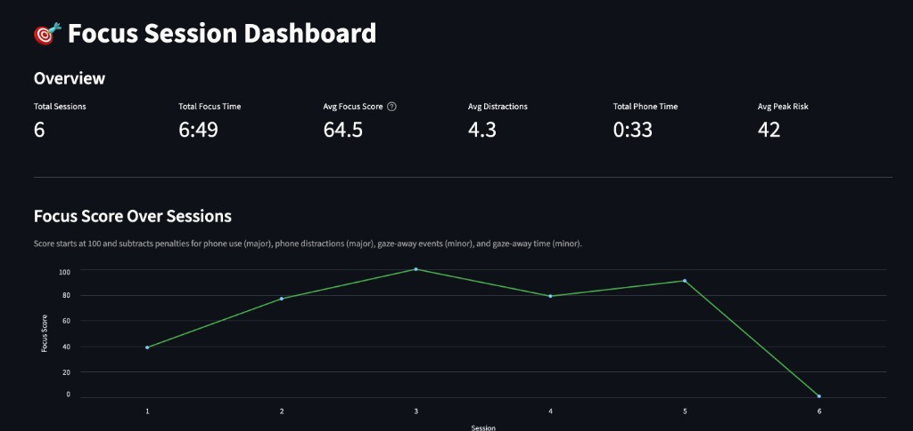

**Session analytics** — phone time, distractions, and risk charts.

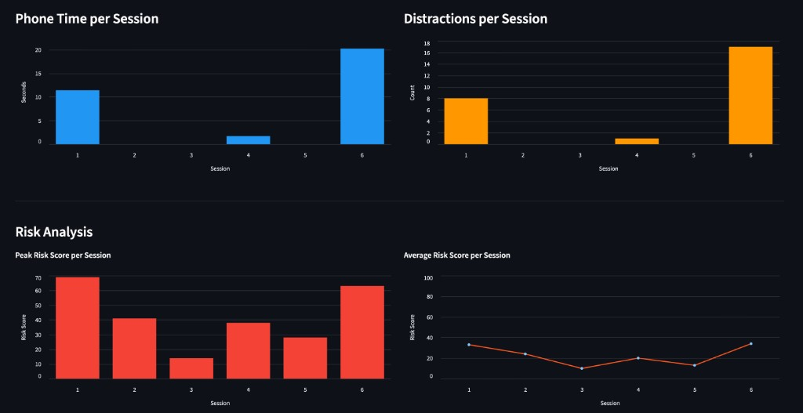

**Risk & gaze analysis**

| Risk analysis | Gaze analysis |
| :---: | :---: |
| 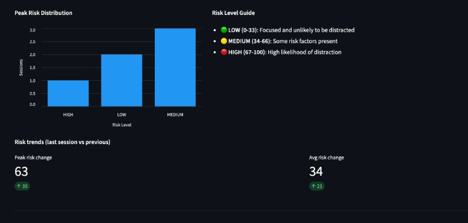 | 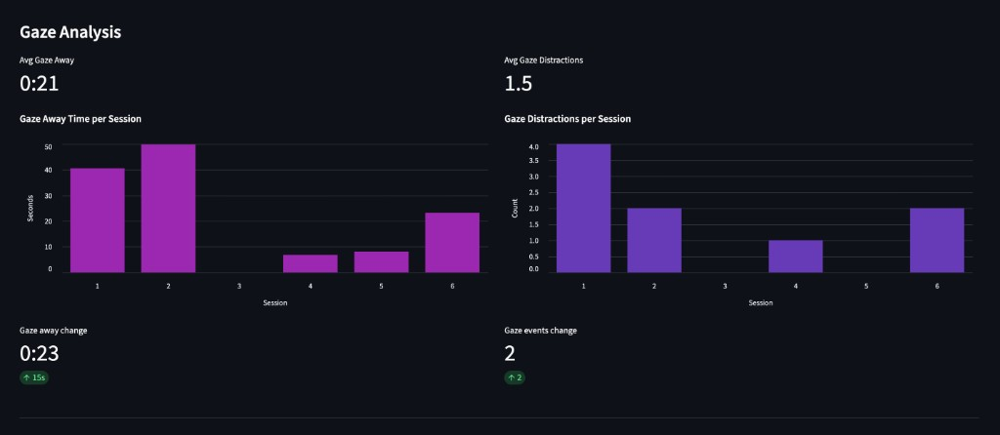 |

**Session history** — full table with focus scores, risk, and gaze metrics.

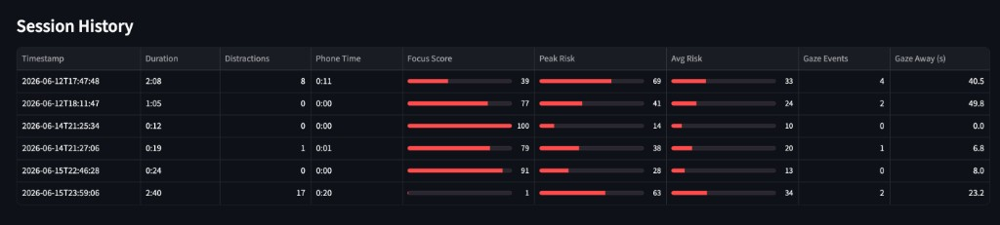

---

## Project Overview

Most Pomodoro timers measure time — not *attention*. **AI Focus Assistant** runs a real-time webcam pipeline that detects phone use and look-away behavior, scores each focus session, estimates live distraction risk, and logs history for analytics.

Modular design: detection, gaze tracking, Pomodoro, risk estimation, persistence, and analytics are separate modules orchestrated by `webcam_demo.py`.

---

## Features

- **Real-time CV** — YOLOv8 phone/person detection + MediaPipe head-pose gaze tracking
- **Pomodoro sessions** — 25/5 focus/break cycles with live HUD and session summaries
- **Behavioral intelligence** — live LOW / MEDIUM / HIGH risk with predictive warnings
- **Analytics** — CSV logging, CLI trends, and a Streamlit dashboard

---

## Architecture

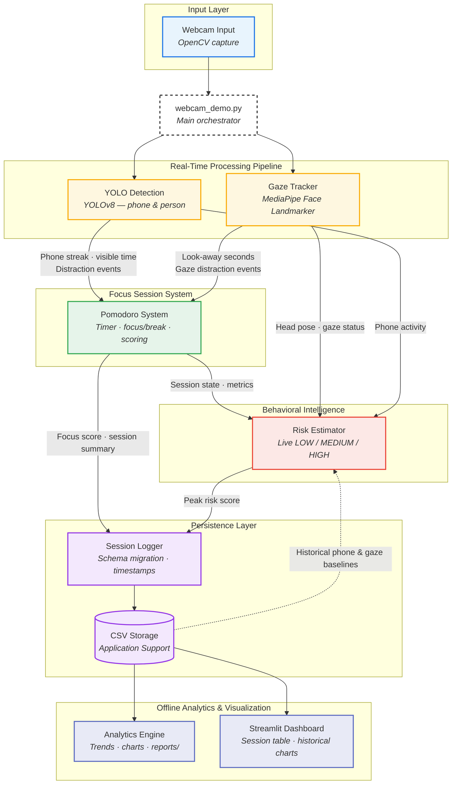

**Stack:** OpenCV · YOLOv8 · MediaPipe · Python · CSV · Matplotlib · Streamlit

---

## Installation

**Requirements:** Python 3.10+, webcam, macOS / Linux / Windows

```bash
git clone https://github.com/oryangdo/summer_project.git
cd summer_project

python3 -m venv .venv
source .venv/bin/activate        # Windows: .venv\Scripts\activate

pip install -r requirements.txt
```

First run auto-downloads YOLO weights and the MediaPipe face model into your user cache if they are not bundled with the app.

### Download for macOS (no Python required)

**End users:** download the latest **`AI-Focus-Assistant-mac.zip`** from [GitHub Releases](https://github.com/oryangdo/summer_project/releases).

The release zip contains:

| Item | Description |
|------|-------------|
| `AI Focus Assistant.app` | Standalone focus sessions only (~1 GB) |
| `README.txt` | Unzip instructions, Gatekeeper workaround, camera permission, session data path |

It does **not** include the Streamlit dashboard. The dashboard requires cloning the repo and a one-time Python setup (see [Analytics & dashboard](#analytics--dashboard)).

```
Unzip → open AI-Focus-Assistant-mac → double-click AI Focus Assistant.app
→ allow camera → press SPACE to start → session saves automatically → summary appears
```

**First launch (Gatekeeper):** macOS may block the unsigned app. Right-click **AI Focus Assistant.app** → **Open** → confirm **Open**. After that, double-click works normally. Full steps are in the zip’s `README.txt`.

No Terminal or Python setup is required for focus sessions in the release zip.

### Desktop use (macOS, from source)

**Option A — repo launchers (one-time Python setup)**

```bash
./scripts/setup_mac_apps.sh
```

Then double-click:

| App | What it does |
|-----|----------------|
| `macos/AI Focus Assistant.app` | Opens the live webcam focus session |
| `macos/Open Dashboard.app` | Opens the Streamlit dashboard in your browser |

**Option B — build a release zip (maintainers)**

On macOS, build and verify a GitHub Release artifact:

```bash
./scripts/release_mac.sh
```

This runs PyInstaller, packages `release/AI-Focus-Assistant-mac.zip` (focus app + `README.txt` only), and smoke-tests launch + session save. Upload the zip to [GitHub Releases](https://github.com/oryangdo/summer_project/releases). The zip is gitignored and is not committed to the repository.

Individual steps:

```bash
./scripts/build_mac_app.sh      # PyInstaller build → dist/AI Focus Assistant.app
./scripts/package_release.sh    # → release/AI-Focus-Assistant-mac.zip
./scripts/verify_release.sh     # unzip, launch, and CSV smoke test
```

| Topic | Detail |
|-------|--------|
| Start session | Home screen → press **SPACE** |
| End session | Natural timer end or **Q** during focus → persistent summary overlay |
| Dismiss summary | **ESC** or click **X** |
| Open dashboard | **Source/Python setup only** — clone repo, install requirements, then use **D** / **Open Dashboard** on summary, `Open Dashboard.app`, or `streamlit run`. Not available in the standalone release app. |
| Camera | Allow access when macOS prompts on first launch |
| Session data | `~/Library/Application Support/AI Focus Assistant/data/sessions.csv` |
| Charts | `~/Library/Application Support/AI Focus Assistant/reports/` (CLI analytics; dashboard requires Python setup) |
| Dashboard UI | Opens in **Safari/Chrome** — not embedded in the focus app window |

The **GitHub Release zip** is focus-only: `AI Focus Assistant.app` + `README.txt`. The repo `macos/` launchers run from source after `./scripts/setup_mac_apps.sh` and can open both the focus session and the dashboard.

---

## Usage

**Live focus session**

```bash
python webcam_demo.py    # or ./run.sh
```

| Key / action | Behavior |
|--------------|----------|
| **SPACE** | Start focus session from home screen |
| **Q** | Save and show summary if in focus; quit from home/summary |
| **ESC** / **X** | Dismiss session summary |
| **D** / **Open Dashboard** | Open stats in browser (when summary is visible) |

**Analytics & dashboard**

```bash
python -m src.analytics
python -m streamlit run src/dashboard.py
```

Or double-click `macos/Open Dashboard.app` after running `./scripts/setup_mac_apps.sh`.

---

## Analytics

Sessions append to `~/Library/Application Support/AI Focus Assistant/data/sessions.csv` (focus score, distractions, phone/gaze time, risk scores). The CLI prints trends and writes charts to `~/Library/Application Support/AI Focus Assistant/reports/`; the Streamlit dashboard reads the same CSV.

---

## Roadmap

- **In progress:** Stage 10.1 productivity intelligence (derived metrics, personal baselines, habit insights)
- **Next:** Stage 10.2 recommendations + dashboard insights panel
- **Also pending:** config system, public GitHub release

Details: [`MASTER_CHECKLIST.md`](MASTER_CHECKLIST.md) · [`PROJECT_STATUS.md`](PROJECT_STATUS.md)

---

## Troubleshooting

Webcam issues → check camera permissions. Slow FPS → use `yolov8n.pt`. Empty dashboard → complete at least one session first. Import errors → activate `.venv` and reinstall requirements.

---

## License

MIT License — see [LICENSE](LICENSE). Copyright (c) 2026 Orlando Yang.
