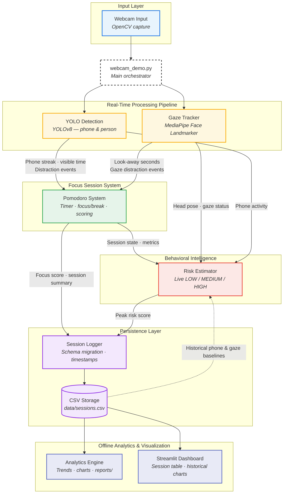

# AI Focus Assistant

An AI-powered productivity system that detects phone and gaze distractions during Pomodoro focus sessions, estimates real-time distraction risk, and turns session history into actionable analytics.

Built with **YOLOv8**, **MediaPipe**, **OpenCV**, and **Streamlit** — a full computer-vision pipeline from webcam input to persistent data and visualization.

---

## Project Overview

Staying focused while studying or working is hard when phones and off-screen attention constantly pull you away. Most Pomodoro timers only measure time — they don't measure *attention*.

**AI Focus Assistant** closes that gap. It runs a real-time webcam pipeline that:

1. Detects phone distractions with object detection
2. Tracks head pose and look-away behavior with face landmarks
3. Scores each focus session based on phone and gaze metrics
4. Estimates live distraction risk using session signals and personal history
5. Logs every session to CSV and surfaces trends through CLI analytics and a Streamlit dashboard

The codebase is modular by design — detection, gaze tracking, session management, risk estimation, persistence, and analytics are separate modules orchestrated by a single entry point. That structure keeps the system readable today and makes future ML-based risk models straightforward to plug in.

---

## Features

### Real-Time Detection
- Webcam capture via OpenCV with live FPS monitoring
- **YOLOv8** object detection (phone and person classes)
- Confidence thresholding and streak-based phone detection to reduce false positives
- **MediaPipe Face Landmarker** head-pose / gaze-away tracking
- Personal baseline calibration (~3 s) with deviation-based look-away detection

### Focus Session System
- Pomodoro timer with focus / break modes (25 min / 5 min default)
- Phone visible time and distraction event tracking
- Gaze-away time and gaze distraction events (5+ s continuous look-away)
- Focus score (0–100) with phone and gaze penalties
- Live HUD with gaze status (`CAL` / `FWD` / `AWAY` / `NO FACE`), timer, risk level, and session metrics
- Session summary overlay on completion

### Behavioral Intelligence
- Live distraction risk score (`LOW` / `MEDIUM` / `HIGH`)
- Multi-factor heuristic model: session fatigue, recent phone activity, live gaze pose, and historical CSV baselines
- Predictive on-screen warnings (phone streak, gaze look-away, rising risk)
- ML-ready risk estimator interface for future model swap-in

### Persistence & Analytics
- Append-only CSV session logging with automatic schema migration
- Historical data persists between runs
- CLI analytics: trends, rolling averages, personal records, time-of-day analysis
- Chart generation saved to `reports/`
- Streamlit dashboard with session table, aggregate metrics, and historical charts

---

## Architecture

`webcam_demo.py` orchestrates the real-time pipeline. Completed sessions flow into CSV storage and are consumed offline by the analytics engine and dashboard.



### Tech Stack

| Layer | Technologies |
|-------|-------------|
| Computer vision | OpenCV, Ultralytics YOLOv8, MediaPipe Face Landmarker |
| Session & logic | Python 3.10+, dataclasses, modular src/ packages |
| Data | CSV persistence with schema migration |
| Analytics | NumPy, Matplotlib |
| Dashboard | Streamlit, Pandas |

---

## Screenshots

> Screenshot assets are planned for the public release (Stage 9). Run the project locally to see the live experience today.

| View | What you'll see |
|------|-----------------|
| **Live HUD** | Pomodoro timer, phone detection status, gaze indicator, live risk level, FPS, and object count overlaid on the webcam feed |
| **Session Summary** | End-of-session overlay with focus score, phone time, gaze metrics, and peak risk |
| **Analytics CLI** | Terminal summary with trends, rolling averages, personal records, and chart paths |
| **Streamlit Dashboard** | Session history table, aggregate metrics, and focus / phone / risk / gaze trend charts |

When assets are ready, add them under `docs/images/` and embed like this:

```markdown


```

---

## Installation

### Prerequisites

- **Python 3.10+**
- **Webcam** (for the live demo)
- macOS, Linux, or Windows

### Setup

```bash
git clone https://github.com/<your-username>/summer_project.git
cd summer_project

python3 -m venv .venv
source .venv/bin/activate        # Windows: .venv\Scripts\activate

pip install -r requirements.txt
```

### First-run downloads

On first launch, the app automatically downloads:

| Asset | Size | Purpose |
|-------|------|---------|
| `yolov8s.pt` | ~22 MB | YOLOv8 detection weights (Ultralytics) |
| `models/face_landmarker.task` | ~3 MB | MediaPipe face landmark model |

These files are gitignored and cached locally after the first run.

---

## Usage

### 1. Run a live focus session

```bash
python webcam_demo.py
```

Or use the helper script:

```bash
./run.sh
```

**Controls**

| Key | Action |
|-----|--------|
| `q` | Quit (saves the current focus session if one is active) |

During a focus session the HUD shows timer mode, phone detection status, gaze state, live risk level, FPS, and detection summary. Predictive warnings appear when phone streaks or look-away behavior suggest rising distraction risk.

### 2. Generate analytics (terminal + charts)

After completing one or more sessions:

```bash
python -m src.analytics
```

This prints a summary to the terminal and writes charts to `reports/` (e.g. focus trends, phone usage, risk trends, gaze metrics).

### 3. Open the Streamlit dashboard

```bash
python -m streamlit run src/dashboard.py
```

Open the URL Streamlit prints (typically `http://localhost:8501`) to browse session history, aggregate metrics, and interactive charts.

---

## Analytics

All session data is stored in `data/sessions.csv` with this schema:

| Column | Description |
|--------|-------------|
| `timestamp` | Session start time |
| `duration_seconds` | Focus session length |
| `distractions` | Phone distraction events |
| `phone_visible_seconds` | Total time phone was visible |
| `focus_score` | 0–100 session score |
| `peak_risk_score` | Highest live risk during session |
| `avg_risk_score` | Average live risk during session |
| `gaze_distractions` | Look-away events (5+ s each) |
| `gaze_away_seconds` | Total time looking away from screen |

### Focus score formula

Score starts at 100 and subtracts penalties (clamped to 0–100):

| Penalty | Weight |
|---------|--------|
| Phone time share | `(phone_visible_seconds / duration) × 50` |
| Phone distractions | `distractions × 5` |
| Gaze distractions | `gaze_distractions × 2` |
| Gaze away share | `(gaze_away_seconds / duration) × 25` |

### What analytics provides

**CLI (`src/analytics.py`)**
- Aggregate stats across all sessions
- Focus, phone, risk, and gaze trend analysis
- Rolling averages and personal records
- Time-of-day productivity breakdown
- PNG charts in `reports/`

**Dashboard (`src/dashboard.py`)**
- Searchable session history table
- Summary metrics with formula help text
- Line charts for focus score, distractions, phone time, risk, and gaze over time

---

## Project Structure

```
summer_project/
├── webcam_demo.py          # Main entry: webcam + YOLO + gaze + Pomodoro + risk HUD
├── run.sh                  # Shortcut to launch webcam_demo.py
├── requirements.txt
├── src/
│   ├── gaze_tracker.py     # MediaPipe head-pose / gaze-away tracking
│   ├── hud.py              # OpenCV HUD overlays and session summary
│   ├── pomodoro.py         # Pomodoro timer and focus scoring
│   ├── risk_estimator.py   # Heuristic distraction risk (ML-ready interface)
│   ├── session_logger.py   # CSV persistence and schema migration
│   ├── analytics.py        # Historical stats and chart generation
│   └── dashboard.py        # Streamlit UI
├── data/                   # Created at runtime (sessions.csv)
├── models/                 # Face landmarker model (downloaded on first run)
└── reports/                # Charts generated by analytics (gitignored)
```

---

## Future Roadmap

| Stage | Status | Description |
|-------|--------|-------------|
| **Stages 1–6** | Complete | Webcam pipeline, distraction detection, Pomodoro, CSV logging, analytics, dashboard |
| **Stage 7** | Complete | Behavioral intelligence — live risk, warnings, risk analytics |
| **Stage 8.1** | Complete | Gaze-away detection, HUD integration, logging, analytics, historical gaze risk baselines |
| **Stage 8.1 polish** | In progress | Live HUD gaze-away total, session summary on quit-with-q |
| **Stage 9** | Planned | Config system, UI polish, dashboard redesign, screenshots, demo video, public release |
| **Stage 10+** | Future | ML-based distraction prediction, multi-user support, desktop packaging, study recommendations |

See [`MASTER_CHECKLIST.md`](MASTER_CHECKLIST.md) for the full engineering checklist and [`PROJECT_STATUS.md`](PROJECT_STATUS.md) for current implementation details.

---

## Troubleshooting

| Issue | Suggestion |
|-------|------------|
| Webcam won't open | Close other apps using the camera; check OS camera permissions |
| Slow FPS | Switch to `yolov8n.pt` in `webcam_demo.py` for a lighter model |
| No data in dashboard | Complete or quit (`q`) at least one focus session first |
| `ModuleNotFoundError` | Activate `.venv` and run `pip install -r requirements.txt` |
| Face landmarker download fails | Check network access; model saves to `models/face_landmarker.task` |

---

## License

Add a license file before publishing this repository publicly.
