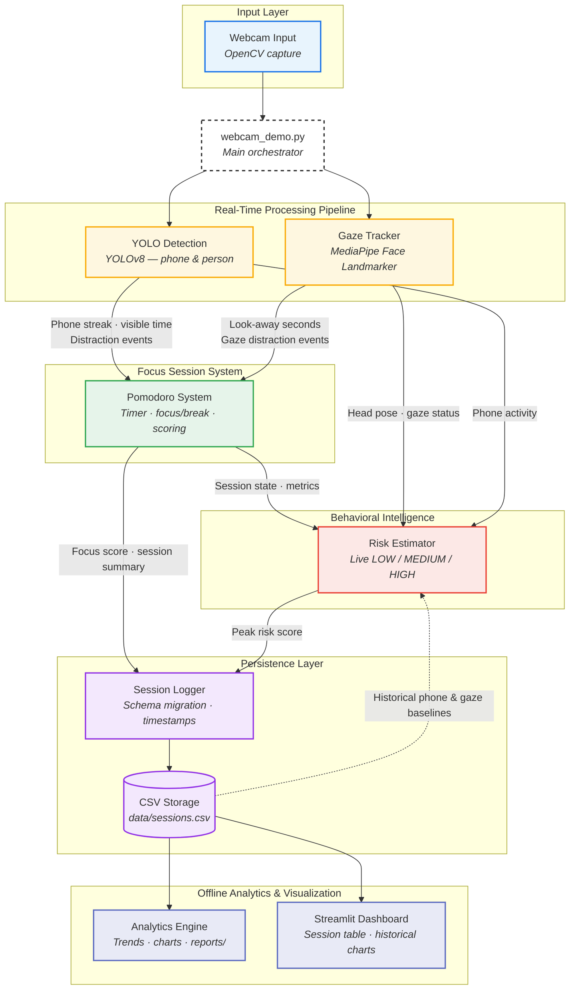

# AI Focus Assistant

An AI-powered productivity system that detects phone and gaze distractions during Pomodoro focus sessions, estimates real-time distraction risk, and turns session history into actionable analytics.

Built with **YOLOv8**, **MediaPipe**, **OpenCV**, and **Streamlit**.

---

## Demo

**[▶ Watch demo video](https://youtu.be/PLACEHOLDER)** *(add link when ready)*

A 60–90 second walkthrough: live focus session → phone/gaze detection → session summary → dashboard.

---

## Screenshots

| Live focus HUD | Session summary |
|:---:|:---:|
|  |  |
| Pomodoro timer, gaze status, live risk, phone detection | Focus score, phone time, gaze metrics, peak risk |

| Streamlit dashboard | Analytics charts |
|:---:|:---:|
|  |  |
| Session history, aggregate metrics, trend lines | CLI-generated focus, phone, risk, and gaze charts |

> Add PNGs to `docs/images/` before publishing. Paths above are ready to use once assets exist.

---

## GIFs

| Phone detection | Gaze tracking | Risk warning |
|:---:|:---:|:---:|
|  |  |  |
| YOLO streak-based phone alert | Head-pose look-away detection | Predictive on-screen warning |

> Short screen recordings (5–15 s each) work well here. Export as GIF or use GitHub-supported formats.

---

## Project Overview

Most Pomodoro timers measure time — not *attention*. **AI Focus Assistant** runs a real-time webcam pipeline that detects phone use and look-away behavior, scores each focus session, estimates live distraction risk, and logs history for analytics.

Modular design: detection, gaze tracking, Pomodoro, risk estimation, persistence, and analytics are separate modules orchestrated by `webcam_demo.py`.

---

## Features

- **Real-time CV** — YOLOv8 phone/person detection + MediaPipe head-pose gaze tracking
- **Pomodoro sessions** — 25/5 focus/break cycles with live HUD and session summaries
- **Behavioral intelligence** — live LOW / MEDIUM / HIGH risk with predictive warnings
- **Analytics** — CSV logging, CLI trends, and a Streamlit dashboard

---

## Architecture



**Stack:** OpenCV · YOLOv8 · MediaPipe · Python · CSV · Matplotlib · Streamlit

---

## Installation

**Requirements:** Python 3.10+, webcam, macOS / Linux / Windows

```bash
git clone https://github.com/oryangdo/summer_project.git
cd summer_project

python3 -m venv .venv
source .venv/bin/activate        # Windows: .venv\Scripts\activate

pip install -r requirements.txt
```

First run auto-downloads YOLO weights (`yolov8s.pt`) and the MediaPipe face model (`models/face_landmarker.task`).

---

## Usage

**Live focus session**

```bash
python webcam_demo.py    # or ./run.sh
```

Press `q` to quit — saves the current session if active.

**Analytics & dashboard**

```bash
python -m src.analytics
python -m streamlit run src/dashboard.py
```

---

## Analytics

Sessions append to `data/sessions.csv` (focus score, distractions, phone/gaze time, risk scores). The CLI prints trends and writes charts to `reports/`; the Streamlit dashboard shows session history and aggregate metrics.

---

## Roadmap

- **Next:** UI polish, config system, screenshots/GIFs, demo video, public release (Stage 9)
- **Future:** ML-based distraction prediction, desktop packaging, study recommendations

Details: [`MASTER_CHECKLIST.md`](MASTER_CHECKLIST.md) · [`PROJECT_STATUS.md`](PROJECT_STATUS.md)

---

## Troubleshooting

Webcam issues → check camera permissions. Slow FPS → use `yolov8n.pt`. Empty dashboard → complete at least one session first. Import errors → activate `.venv` and reinstall requirements.

---

## License

Add a license file before publishing this repository publicly.
