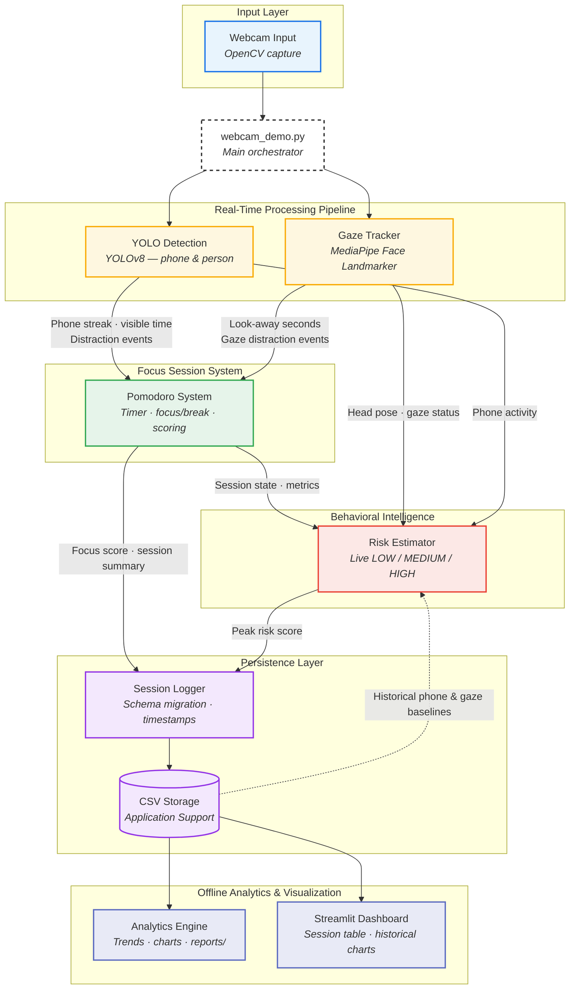

# AI Focus Assistant

An AI-powered productivity system that detects phone and gaze distractions during Pomodoro focus sessions, estimates real-time distraction risk, and turns session history into actionable analytics.

Built with **YOLOv8**, **MediaPipe**, **OpenCV**, and **Streamlit**.

---

## Demo

See **Demo video** below. Planned walkthrough: home screen → focus session → session summary → optional dashboard.

---

## Screenshots

Screenshots and GIFs are planned for Stage 9. Add assets to `docs/images/` when ready:

- `live-hud.png` — live focus session with HUD
- `session-summary.png` — session complete overlay with Open Dashboard button
- `dashboard.png` — Streamlit dashboard in browser
- `phone-detection.gif`, `gaze-tracking.gif`, `risk-warning.gif` — short demos

---

## Demo video

**[▶ Watch demo video](https://youtu.be/PLACEHOLDER)** *(coming in Stage 9)*

---

## Project Overview

Most Pomodoro timers measure time — not *attention*. **AI Focus Assistant** runs a real-time webcam pipeline that detects phone use and look-away behavior, scores each focus session, estimates live distraction risk, and logs history for analytics.

Modular design: detection, gaze tracking, Pomodoro, risk estimation, persistence, and analytics are separate modules orchestrated by `webcam_demo.py`.

---

## Features

- **Real-time CV** — YOLOv8 phone/person detection + MediaPipe head-pose gaze tracking
- **Pomodoro sessions** — 25/5 focus/break cycles with live HUD and session summaries
- **Behavioral intelligence** — live LOW / MEDIUM / HIGH risk with predictive warnings
- **Analytics** — CSV logging, CLI trends, and a Streamlit dashboard

---

## Architecture



**Stack:** OpenCV · YOLOv8 · MediaPipe · Python · CSV · Matplotlib · Streamlit

---

## Installation

**Requirements:** Python 3.10+, webcam, macOS / Linux / Windows

```bash
git clone https://github.com/oryangdo/summer_project.git
cd summer_project

python3 -m venv .venv
source .venv/bin/activate        # Windows: .venv\Scripts\activate

pip install -r requirements.txt
```

First run auto-downloads YOLO weights and the MediaPipe face model into your user cache if they are not bundled with the app.

### Desktop use (macOS)

**Option A — repo launchers (one-time Python setup)**

```bash
./scripts/setup_mac_apps.sh
```

Then double-click:

| App | What it does |
|-----|----------------|
| `macos/AI Focus Assistant.app` | Opens the live webcam focus session |
| `macos/Open Dashboard.app` | Opens the Streamlit dashboard in your browser |

**Option B — standalone release zip (focus app for end users)**

Build and package on your Mac:

```bash
./scripts/build_mac_app.sh
./scripts/package_release.sh
```

Output: `release/AI-Focus-Assistant-mac.zip` containing:

| App | What it does |
|-----|----------------|
| `AI Focus Assistant.app` | Standalone focus session (~1 GB, no Python required) |
| `Open Dashboard.app` | Opens dashboard in browser (requires Python + Streamlit setup) |

| Topic | Detail |
|-------|--------|
| Start session | Home screen → press **SPACE** |
| End session | Natural timer end or **Q** during focus → persistent summary overlay |
| Dismiss summary | **ESC** or click **X** |
| Open dashboard | Click **Open Dashboard** on summary, press **D**, or use `Open Dashboard.app` |
| Camera | Allow access when macOS prompts on first launch |
| Session data | `~/Library/Application Support/AI Focus Assistant/data/sessions.csv` |
| Charts | `~/Library/Application Support/AI Focus Assistant/reports/` |
| Dashboard UI | Opens in **Safari/Chrome** — not embedded in the focus app window |

The focus app and dashboard are **two separate apps**. The standalone focus `.app` does not bundle Streamlit; use `Open Dashboard.app` (with Python installed) when you want full history and charts.

---

## Usage

**Live focus session**

```bash
python webcam_demo.py    # or ./run.sh
```

| Key / action | Behavior |
|--------------|----------|
| **SPACE** | Start focus session from home screen |
| **Q** | Save and show summary if in focus; quit from home/summary |
| **ESC** / **X** | Dismiss session summary |
| **D** / **Open Dashboard** | Open stats in browser (when summary is visible) |

**Analytics & dashboard**

```bash
python -m src.analytics
python -m streamlit run src/dashboard.py
```

Or double-click `macos/Open Dashboard.app` / `Open Dashboard.app` from the release zip.

---

## Analytics

Sessions append to `~/Library/Application Support/AI Focus Assistant/data/sessions.csv` (focus score, distractions, phone/gaze time, risk scores). The CLI prints trends and writes charts to `~/Library/Application Support/AI Focus Assistant/reports/`; the Streamlit dashboard reads the same CSV.

---

## Roadmap

- **In progress:** Stage 9.1 macOS packaging (build + release zip)
- **Next:** Screenshots/GIFs, demo video, config system, public release
- **Future:** ML-based distraction prediction, study recommendations

Details: [`MASTER_CHECKLIST.md`](MASTER_CHECKLIST.md) · [`PROJECT_STATUS.md`](PROJECT_STATUS.md)

---

## Troubleshooting

Webcam issues → check camera permissions. Slow FPS → use `yolov8n.pt`. Empty dashboard → complete at least one session first. Import errors → activate `.venv` and reinstall requirements.

---

## License

Add a license file before publishing this repository publicly.
